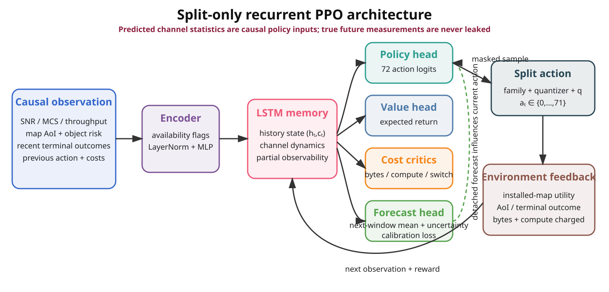
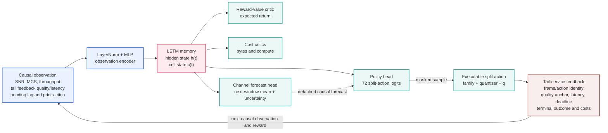

# Split-only recurrent PPO: preliminary architecture v1

Status: **DESIGN + NETWORK SKELETON ONLY — NO TRAINING CLAIM**

## Decision boundary

At every decision epoch the UE chooses one of the 72 measured split profiles:

$$
a_t \in \{0,\ldots,71\}.
$$

Each action fixes the feature family, quantizer and registered drop fraction
$q$. `LOCAL` and `SKIP` are deliberately excluded until their transitions are
measured. Poor but executable split actions remain learnable outcomes; the
action mask is reserved for actions that cannot physically execute.

## Why recurrence is needed

The current SNR is insufficient by itself. OAI channels evolve over time, and
the UE does not directly observe the next channel state or the complete edge
state. The LSTM summarizes causal history:

$$
(h_t,c_t)=\operatorname{LSTM}(e(o_t),h_{t-1},c_{t-1}).
$$

An auxiliary head predicts the channel distribution over the service interval
of the action being selected. The **prediction itself** (mean and uncertainty)
is supplied to the current policy, while the true future SNR becomes a target
only after the transition. Thus the policy is proactive without leaking a
future measurement.

In plain language, the LSTM gives the agent a short-term memory. At decision
epoch $t$, it receives the encoded current observation and its two memory
vectors from epoch $t-1$:

- the **cell state** $c_{t-1}$ carries longer-lived context, such as whether
  the channel has been steadily degrading or recovering;
- the **hidden state** $h_{t-1}$ is the compact summary exposed to the policy,
  value and forecast heads; and
- learned input, forget and output gates decide what new evidence to store,
  what old evidence to retain and what part of the memory to expose.

This matters because two epochs can have the same instantaneous SNR but imply
different decisions. A falling SNR sequence may favor a smaller payload before
congestion develops, whereas the same SNR during recovery may support a less
aggressive action. Recent delivery, supersession and tail-feedback history also help
the memory distinguish a brief radio dip from a persistent service backlog.

## Causal observation groups

The first simulator should expose normalized values and availability flags for:

- current and lagged PUSCH SNR, MCS and delivered throughput;
- current-frame sensor-compute elapsed time and the remaining portion of the
  140-ms service budget, both known when the split action is selected;
- recent complete-message delivery and terminal-outcome history;
- last received tail-feedback frame/action identity represented as lag, its
  segmentation/localization quality anchor or deployable proxy plus
  availability/provenance, feedback latency divided by 140 ms, deadline result
  and feedback age;
- oldest-pending-frame lag, pending age/count and the latest explicit terminal
  outcome;
- edge busy/pending state plus recent supersession and expiry outcomes;
- previous action and payload; and
- causal ego/object-risk summaries available before action selection.

Forbidden inputs are the authored network-profile name, future SNR, CARLA
ground truth, and the current frame's eventual tail result.

The exact asynchronous attribution and missing-feedback behavior is frozen in
[AGENT_TIMELINE_AND_DELAYED_FEEDBACK_V1.md](AGENT_TIMELINE_AND_DELAYED_FEEDBACK_V1.md).
In particular, absence of feedback at the next frame means `PENDING`, not
`LOST`; crossing 140 ms yields `DEADLINE_MISSED_PENDING`, which is a service
miss but still not a radio-loss diagnosis. Later feedback closes the exact
frame/action ticket.

## Network

`model.py` implements the initial network:

This is PPO with recurrent state, hard executability masking and an auxiliary
forecast objective. It is a composition of established techniques, not a new
algorithm called “Recurrent Hierarchical Masked PPO.”

### How the LSTM plugs into PPO

The LSTM is not a separate controller placed in front of PPO. It replaces the
memoryless feature layer inside the actor-critic network:

1. The UE forms only the information available before choosing $a_t$.
2. The encoder converts that observation to a compact feature vector.
3. The LSTM updates $(h_t,c_t)$ from that feature and the previous memory.
4. The forecast head produces a causal next-window channel belief; the policy
   head converts $[h_t;\operatorname{sg}(\widehat\mu_t,
   \log\widehat\sigma_t)]$ into probabilities over the 72 split actions.
5. The value and two cost heads use the same $h_t$ to estimate future reward,
   normalized byte cost and compute cost. Those two resource terms are not
   subtracted again from the v1 scalar reward. The action-switch, proven-loss
   and 140-ms miss terms remain explicit scalar penalties.
6. The forecast head predicts channel mean and uncertainty over the period in
   which $a_t$ will travel. A stop-gradient copy of that prediction is appended
   to $h_t$ before the policy head, so it influences the current action. This
   blocks the direct policy-loss path into forecast-head parameters; the shared
   encoder/LSTM remains coupled and must be controlled by the forecast loss and
   tested for held-out prediction quality.

During training, rollouts retain the observation, chosen action, reward,
terminal flag, incoming LSTM state and the detached forecast features used by
the sampled policy. PPO re-evaluation uses those stored forecast features;
forecast-head updates therefore cannot silently change an old policy
distribution. Parameters remain frozen while collecting a rollout, and actual
policy KL is monitored after every optimizer step. PPO optimizes short
contiguous sequences so gradients can teach the memory which past signals matter. The
memory resets at the start of a new episode or UE session; in a future
multi-UE deployment, each UE keeps its own state so histories cannot leak
between vehicles.

Formally,

$$
(\widehat\mu_{t,H_{\mathrm{ch}}},\widehat\sigma_{t,H_{\mathrm{ch}}})
=g_\psi(h_t),
$$

$$
\pi_\theta(a_t\mid o_{\le t})=
\operatorname{softmax}\!\left(
W_\pi[\,h_t;\operatorname{sg}(\widehat\mu_{t,H_{\mathrm{ch}}},
\log\widehat\sigma_{t,H_{\mathrm{ch}}})\,]+b_\pi
\right),
$$

where $H_{\mathrm{ch}}=100$ ms is the registered future radio-exposure window
and `sg` means stop-gradient. It is deliberately distinct from the 140-ms
end-to-end feedback deadline. The v1 target is the mean SNR observed over that
next channel window, not one noisy sample.
The registered three-arm ablation compares no forecast, auxiliary-only
forecasting and the explicit detached forecast input. Future windows without a
valid SNR target are masked from the forecast loss. True future SNR is never
available at action selection.

## Tail-service feedback and deferred map outcome

Model-tail completion can shorten control uncertainty, but it is not the same
event as a successful spatial-map installation. The first experiment registers
`tail_only_v1`: the PPO service ticket ends at tail feedback, while map outcome
is retained on an independent audit/evaluation stream.

1. After synchronized model-tail completion, the edge sends a compact
   `TAIL_COMPLETED_ACK`. On the wire it carries exact frame/action identity,
   the edge completion event, actual resource charges, separate
   segmentation/localization quality anchors (or a qualified live proxy), and
   quality source/version/catalog hash. When it arrives, the UE stamps the
   receipt time and derives the same-clock feedback latency and 140-ms result.
   The enriched UE record closes the first-phase service ticket.
2. `MAP_OUTCOME` is emitted after post-processing and map handling. It records
   `INSTALLED`, `SUPERSEDED`, `REJECTED` or another registered outcome, but it
   does not retroactively mutate an already-consumed PPO transition.

An early ACK cannot truthfully contain realized per-frame
segmentation/localization accuracy, p025 object records or installed-frame ID
before those later stages exist. In trace-driven training, quality comes from
the frozen action table and receives credit only after tail completion; live
deployment requires a qualified proxy or the fixed offline quality prior.
Absence at the next frame remains `PENDING`, not `LOST`; crossing 140 ms marks
`DEADLINE_MISSED_PENDING`, not radio failure.

The timing proposal must also distinguish an illustrative marginal sum from a
causal end-to-end sample. The slide estimate

$$
30_{\rm sensor}+25_{\rm UE}+65_{\rm UL}+21_{\rm tail}=141\ \mathrm{ms}
$$

omits the action-dependent reconstruction required before the 21 ms FCOS tail
and excludes the compact ACK return. The causal replay, on one 40-action common
support with at least 100 samples per stage/profile, places sensor-compute start
to model-tail completion at P50 = 141.7, 148.9, 159.4 and 146.9 ms for
Favorable, Mid, Adverse and Fade respectively. These remain counterfactual
edge-ready times, not received-ACK times.

At 9 FPS, the next decision is nominally ready at roughly 141.1 ms when sensor
compute is about 30 ms. A 140-ms budget is therefore a useful candidate
deadline: among evidence-qualified actions, 18/72, 15/72, 11/72 and 14/72 have
P50 edge-tail completion no greater than 140 ms in Favorable, Mid, Adverse and
Fade respectively. No supported action has P95 no greater than 140 ms, and the
ACK return is still excluded. The agent can learn which actions are likely to
meet the budget, but late feedback remains normal and enters the next available
decision, sometimes frame $j+2$. Retain the pending-ticket ledger and quantify
8/9/10-FPS sensitivity rather than blocking the sensor pipeline.

### Expected policy runtime and training time

The recurrent controller is small relative to the perception pipeline. The
current 259-feature observation-encoder/LSTM/four-head prototype has
approximately 192k parameters (192,483 exactly). On this host, 3,000
single-thread, batch-one CPU forward passes through the complete actor-critic
measured about 0.146 ms at P50, 0.157 ms at P95 and 0.182 ms at P99 after
warm-up. LSTM inference is
therefore not expected to be a service bottleneck next
to tens of milliseconds of sensing, radio and perception work. These are
microbenchmark values, not a live OAI deployment claim; the final integration
must time observation assembly and policy inference together.

Training time is dominated by trace-environment rollout and experimental
replication rather than the LSTM itself. A first trace-driven run should take
tens of minutes to a few hours per random seed; a defensible three-seed set
with the no-forecast, auxiliary-only and explicit-forecast ablations is more
realistically a 6--24 hour workload. Report convergence in environment steps
and wall time rather than promising a fixed duration before the environment is
implemented.

## Deferred map-aware reward and intentional supersession

The equation below is a **later** object-level utility candidate, not the
`tail_only_v1` reward. The revised first-training discussion draft is
[REWARD_FORMULATION_V2.md](REWARD_FORMULATION_V2.md); it keeps segmentation,
localization and latency separately weighted and uses frame ID for exact
causal attribution and frame-lag state rather than as an unbounded scalar
reward input. The asynchronous timing contract remains in
[AGENT_TIMELINE_AND_DELAYED_FEEDBACK_V1.md](AGENT_TIMELINE_AND_DELAYED_FEEDBACK_V1.md).

The reward should use the change in installed-map utility:

$$
r_t=(U_{t+1}-U_t)
 -\lambda_B\frac{B_t}{B_{\max}}
 -\lambda_C\frac{C_t}{C_{\max}}
 -\lambda_S\mathbf{1}[a_t\ne a_{t-1}].
$$

For tracked object $i$, a useful starting map utility is

$$
U_t=
\frac{\sum_i w_i Q_{i,t}\exp(-A_{i,t}/\tau_i)}
     {\sum_i w_i+\varepsilon}.
$$

Here $Q_{i,t}$ means installed-map quality for object $i$; it is deliberately
capitalized so it cannot be confused with the action's dropped-feature
fraction $q$.

### Reward-symbol dictionary

| Symbol | Meaning |
|---|---|
| $t$ | Current decision epoch. |
| $a_t$ | Selected split action: one of the 72 registered family/quantizer/$q$ profiles. |
| $r_t$ | Immediate transition reward. |
| $U_t$ | Utility of the spatial map before the transition. |
| $U_{t+1}-U_t$ | Measured improvement or degradation in installed-map utility. An update that is not installed creates no fictitious quality credit. |
| $i$ | One tracked object in the map. |
| $w_i$ | Application importance of object $i$, such as a larger weight for a vulnerable road user on the ego path. |
| $Q_{i,t}$ | Normalized installed quality/utility contribution for object $i$; this is not compression $q$. |
| $A_{i,t}$ | Object-level Age of Information: current time minus capture time of the newest installed observation for object $i$. |
| $\tau_i$ | Freshness tolerance. The freshness factor is $e^{-1}\approx0.368$ when $A_{i,t}=\tau_i$. |
| $\varepsilon$ | Small positive denominator guard when there are no weighted map objects. |
| $B_t$ | Feature bytes actually charged to the selected action. |
| $B_{\max}$ | Fixed payload normalizer—the largest registered median action payload, not instantaneous network capacity. |
| $C_t$ | Compute actually consumed, including spent work on an intentionally superseded frame. |
| $C_{\max}$ | Fixed compute-cost normalizer. |
| $\lambda_B$ | Communication-cost weight. |
| $\lambda_C$ | Compute-cost weight. |
| $\lambda_S$ | Action-switching penalty weight. |
| $\mathbf{1}[a_t\ne a_{t-1}]$ | Indicator equal to 1 when the action changes and 0 otherwise. |

PPO optimizes the discounted return

$$
G_t=\sum_{k=0}^{\infty}\gamma^k r_{t+k},
$$

where $\gamma\in[0,1)$ controls how strongly later consequences influence the
current decision.

A `SUPERSEDED_PENDING` frame receives no new-map utility because it was never
installed, but it is still charged for bytes and compute already consumed. It
must not be mislabeled as radio loss or structural failure. This lets the
policy learn that a large action can be wasteful when newer information is
likely to overtake it, without punishing the network for an intentional
latest-only scheduling decision.

## How the measurements enter the simulator

- The 288 cells provide action/profile-conditioned payload, delivery and
  original-runtime freshness evidence.
- The final v3 live comparison supplies prospective edge-service distributions
  for actions 30, 50 and 71. It must not be converted into one constant
  subtraction from all historical AoI values.
- The simulator must replay the two-stage latest-only scheduler so faster edge
  service changes supersession, completion and installation nonlinearly.
- Missing v3 actions require a conservative calibrated service model with an
  uncertainty flag, followed by fixed-action reproduction tests before PPO.
- Action 15's earlier v3 non-finite verdict was traced to missing cross-stream
  CUDA tensor-lifetime ownership, not non-finite model output. The repaired v3
  validator passed live and action 15 remains executable; the superseded false
  verdict must not become an action mask.

## Next implementation gate

Before PPO training, implement a causal trace-driven environment and require it
to reproduce held fixed-action statistics for payload, complete reassembly,
supersession, edge completion, installation probability and map AoI. Training
starts only after those checks pass. The registered forecast ablation has three
arms: no forecast, auxiliary-only forecast, and forecast supplied to the
current policy.

# Old and Updated Reward Formulations

## 1. Definitions

For policy decision $t$, let:

- $a_t = (m_t,q_t)$: selected compression mode and compression setting.
- $L_t$: elapsed time from action-open to feedback receipt at the UE, in milliseconds.
- $D = 170\,\mathrm{ms}$: inclusive feedback deadline.
- $c \in \{v,p\}$: vehicle and person classes.
- $N_{t,c}$: number of eligible ground-truth objects.
- $\mathcal{M}_{t,c}$: prediction–GT matches accepted by the existing 3 m matching gate.
- $TP_{t,c} = |\mathcal{M}_{t,c}|$: number of accepted matches.

The planar localization error of matched object $j$ is

$$
e_{t,c,j}
=
\sqrt{
(\hat{x}_{t,c,j}-x_{t,c,j})^2
+
(\hat{y}_{t,c,j}-y_{t,c,j})^2
}.
$$

The class weights are

$$
w_v = 0.4,
\qquad
w_p = 0.6.
$$

Only classes with eligible GT contribute to localization quality:

$$
\mathcal{C}_t
=
\{c \in \{v,p\}:N_{t,c}>0\}.
$$

Weights are renormalized over the participating classes:

$$
\bar{w}_{t,c}
=
\frac{w_c}{\sum_{k\in\mathcal{C}_t}w_k}.
$$

If neither class has eligible GT, localization quality is undefined,
not zero.

## 2. Segmentation Quality — Shared by Both Formulations

Let $G_{t,c}$ and $P_{t,c}$ denote the GT and predicted pixel sets
after applying the evaluation contract's pixel mask.

For a nonempty union,

$$
\operatorname{IoU}_{t,c}
=
\frac{|G_{t,c}\cap P_{t,c}|}
{|G_{t,c}\cup P_{t,c}|}.
$$

Normalize each class IoU using its fixed reference:

$$
s_{t,c}
=
\min\left(
\frac{\operatorname{IoU}_{t,c}}{b_c},
1
\right),
$$

where

$$
b_v = 0.899012847,
\qquad
b_p = 0.52789408.
$$

The segmentation class set is

$$
\mathcal{S}_t
=
\{c:|G_{t,c}\cup P_{t,c}|>0\}.
$$

For $\mathcal{S}_t\neq\varnothing$, segmentation quality is the
weighted geometric mean:

$$
Q_{\mathrm{seg},t}
=
\prod_{c\in\mathcal{S}_t}
s_{t,c}^{\,
w_c/\sum_{k\in\mathcal{S}_t}w_k}.
$$

A participating class with zero IoU makes this geometric mean zero.
A class with both GT and prediction masks empty is excluded.

Define the segmentation modifier:

$$
M_t
=
\begin{cases}
0.7+0.3Q_{\mathrm{seg},t},
& \mathcal{S}_t\neq\varnothing,\\
1,
& \mathcal{S}_t=\varnothing.
\end{cases}
$$

The second case means both class unions are empty in valid evidence.
Missing or malformed evidence is not silently treated as perfect
segmentation.

## 3. Old Localization Quality and Perception Quality

### 3.1 Recall within the original matching gate

For each class with eligible GT,

$$
R^{\mathrm{gate}}_{t,c}
=
\frac{TP_{t,c}}{N_{t,c}}.
$$

This counts matches accepted within 3 m, including matches outside
our desired 1.0 m vehicle and 1.2 m person tolerances.

### 3.2 Soft localization utility

For classes with at least one match, define the median matched error:

$$
\tilde{e}_{t,c}
=
\operatorname{median}
\{e_{t,c,j}:j\in\mathcal{M}_{t,c}\}.
$$

The per-class localization utility is

$$
U_{t,c}
=
\begin{cases}
\sqrt{
R^{\mathrm{gate}}_{t,c}
\exp\left(-\dfrac{\tilde{e}_{t,c}}{\tau_c}\right)
},
& TP_{t,c}>0,\\
0,
& TP_{t,c}=0,
\end{cases}
$$

with error-decay scales

$$
\tau_v = 1.0\,\mathrm{m},
\qquad
\tau_p = 1.2\,\mathrm{m}.
$$

These are soft decay scales, not hard accuracy thresholds.

### 3.3 Combined localization and perception quality

For $\mathcal{C}_t\neq\varnothing$,

$$
Q_{\mathrm{loc},t}^{\mathrm{old}}
=
\prod_{c\in\mathcal{C}_t}
U_{t,c}^{\bar{w}_{t,c}}.
$$

A zero utility in any participating class makes this geometric mean zero.

The original perception-quality score is

$$
Q_{\mathrm{perc},t}
=
Q_{\mathrm{loc},t}^{\mathrm{old}}M_t.
$$

When segmentation is defined, this becomes

$$
Q_{\mathrm{perc},t}
=
Q_{\mathrm{loc},t}^{\mathrm{old}}
\left(0.7+0.3Q_{\mathrm{seg},t}\right).
$$

This is multiplicative modulation, not the additive expression
$0.7Q_{\mathrm{loc},t}+0.3Q_{\mathrm{seg},t}$.

### 3.4 Old reward

$$
r_t^{\mathrm{old}}
=
\begin{cases}
Q_{\mathrm{perc},t}
-
0.25\dfrac{L_t}{D},
& L_t\le D \text{ and quality is defined},\\
-1,
& \text{timeout or registered delivery/service failure},\\
\text{excluded},
& \text{evaluator or infrastructure fault}.
\end{cases}
$$

A missing reply becomes a timeout at the deadline.

For example, a timely reply with zero perception quality at 150 ms earns

$$
r_t^{\mathrm{old}}
=
0-0.25\frac{150}{170}
\approx -0.221,
$$

whereas a timeout earns $-1$.

Thus, even a zero-quality timely reply is substantially less penalized
than a timeout.

## 4. Updated Localization-Focused Reward

The updated objective replaces the soft localization utility with
recall within explicit accuracy tolerances.

### 4.1 Within-tolerance recall

The tolerances are

$$
d_v = 1.0\,\mathrm{m},
\qquad
d_p = 1.2\,\mathrm{m}.
$$

For each class with eligible GT, count individually accurate matches:

$$
K_{t,c}
=
\sum_{j\in\mathcal{M}_{t,c}}
\mathbf{1}\left[e_{t,c,j}\le d_c\right].
$$

Then

$$
R^{\mathrm{tol}}_{t,c}
=
\frac{K_{t,c}}{N_{t,c}}.
$$

Unmatched eligible objects and matches outside tolerance earn no
numerator credit, while remaining represented in the denominator.

The original 3 m matching gate remains unchanged. The stricter
1.0 m / 1.2 m thresholds determine reward credit.

### 4.2 Combined within-tolerance quality

For $\mathcal{C}_t\neq\varnothing$,

$$
Y_t
=
\sum_{c\in\mathcal{C}_t}
\bar{w}_{t,c}R^{\mathrm{tol}}_{t,c}.
$$

When both classes have eligible GT,

$$
Y_t
=
0.4R^{\mathrm{tol}}_{t,v}
+
0.6R^{\mathrm{tol}}_{t,p}.
$$

Unlike the old localization combiner, this is an arithmetic weighted
mean. A zero score for one class does not erase the other class's
contribution.

### 4.3 Updated reward

$$
r_t^{\mathrm{new}}
=
\begin{cases}
Y_tM_t,
& L_t\le D \text{ and quality is defined},\\
0,
& \text{late or missing feedback},\\
\text{excluded},
& \text{timely feedback with undefined quality}.
\end{cases}
$$

When segmentation is defined,

$$
\boxed{
r_t^{\mathrm{new}}
=
\begin{cases}
\left(
\displaystyle\sum_{c\in\mathcal{C}_t}
\bar{w}_{t,c}R^{\mathrm{tol}}_{t,c}
\right)
\left(0.7+0.3Q_{\mathrm{seg},t}\right),
& L_t\le170\,\mathrm{ms},\\
0,
& \text{late or missing}.
\end{cases}
}
$$

The boxed expression applies to decisions with defined quality.

In particular,

$$
Y_t=0
\quad\Longrightarrow\quad
r_t^{\mathrm{new}}=0,
$$

even if feedback is timely and segmentation quality is high.

## 5. Interpretation and Important Limits

- The old objective rewarded soft perception quality while penalizing
  latency continuously and assigning a strong timeout penalty.
- The updated objective rewards within-tolerance localization delivered
  on time, with segmentation retained as a modifier.
- The updated reward has no additional latency penalty within 170 ms:
  equally accurate replies at 120 ms and 165 ms receive equal rewards.
- Timely undefined-quality outcomes are excluded and trigger the
  registered session-reset handling. Late undefined-quality replies
  are timeouts, not timely exclusions.
- Neither formulation contains a direct object-detection false-positive
  penalty. False-positive segmentation pixels can still reduce IoU.
- SNR remains part of the Run-5 state; it is not an extra reward term.
- The original Q_perc state feature and the updated scalar reward are
  distinct quantities.
- Reward redesign does not itself prove improved model accuracy or
  policy performance; those require validation.