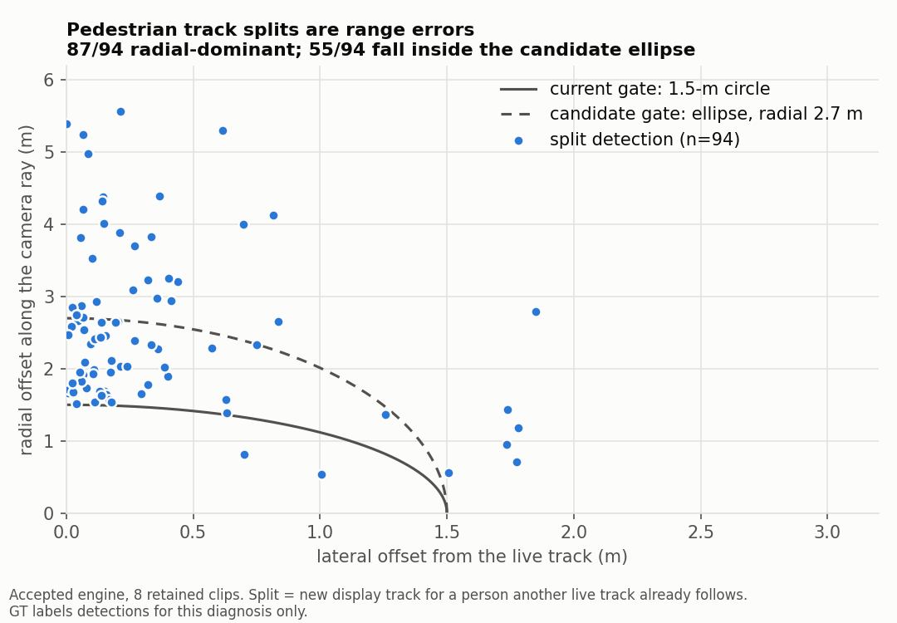
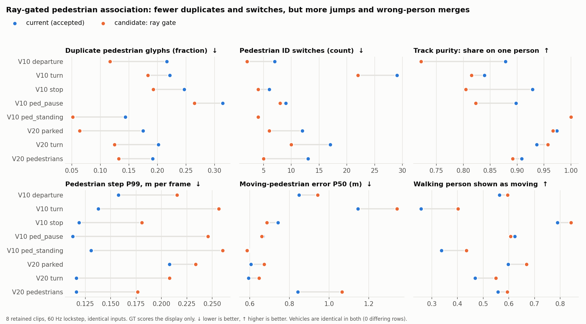

# V20.4 offline study: position stability without delaying genuine movement

**Decision: UPSTREAM CHANGE NEEDED. Keep the current display unchanged.** One display-side candidate was tested and is
**not** proposed for review.

- This is a bounded offline study of the accepted V20.3 display.
- The engine `viewer_assets/replay_tracks_v3.js` (sha256 `50a58726…`), the default pages, the layout, the server, the
  runtime, the map, GT and the scorer are all unchanged.
- No data was collected, no parameter sweep was run, and no live/CARLA/OAI/GPU work was done.
- GT labels and scores only; it never reaches an engine.
- Evidence is in [`artifacts_v20_4_association/`](artifacts_v20_4_association/).

## What the accepted tracker already does

| Area | Implemented | Not implemented |
|---|---|---|
| Confidence | registered evaluator thresholds split strong/weak; weak hits can sustain (≤6 frames) but never create; heading axis is score-weighted | position is not score-weighted |
| Noise model | pedestrian radial 0.9 / lateral 0.2 m priors with ρ=.65 inflation and ego range-drift, used for motion significance and the unresolved ellipse | not used in association; vehicles isotropic |
| Motion fit | vehicles: 1.2-s CV LSQ, t≥3, 2 m displacement, range-rate guard; pedestrians: 2.5-s radial/lateral fit, z≥3 twice, change-point | — |
| Outliers | pedestrians 3σ per axis, then refit; the vehicle stationary median is robust | moving-vehicle fit |
| Blending | 150-ms smoothstep correction; snap above 4 m | — |
| Identity | Hungarian assignment; isotropic gates pedestrian 1.5 m / vehicle 2.5 m (weak 1.0 / 1.5); footprint absorption; conflict groups; expiry 750 ms | reconnection after expiry |

A "Kalman filter" would add nothing in principle here. The constant-velocity least-squares fit is already the
fixed-window equivalent, and V20.3 showed the leftover corrections are drift, not white noise.

## Diagnosis

`analysis_v20_4/fragmentation_diagnosis.cjs` classifies every new display track in 8 retained clips. GT labels
which person a detection belongs to.

- Of 175 GT-backed new pedestrian tracks:
  - 37 are first appearances;
  - **94 are SPLITs**: another live track already followed that person;
  - 44 are reacquisitions after a gap (gap P50 0.25–1.3 s).
- Of the 94 splits:
  - 87 are **radial-dominant** (radial P50 1.8–2.7 m, lateral P50 0.05–0.39 m);
  - in 74, the old track missed that frame, i.e. a gate failure.
- Vehicles split rarely (15 cases).

So the dominant pedestrian disturbance is detector **range error** crossing the 1.5-m circular gate. Each crossing
produces a duplicate glyph, a new ID and a motion-state restart. Range error appears as split-off duplicate
glyphs, not as per-track noise, which is why per-track smoothing (V20.3 EMA) could not help.



## Alternatives considered (maximum three)

| # | Layer | Change | Expected benefit | Failure modes | Cost |
|---|---|---|---|---|---|
| A | association | pedestrian strong-pass gate becomes an ellipse along the camera ray (radial 2.7 m = existing `pedOutlierK × pedSigmaRadialM`, lateral 1.5 m unchanged; the old circle is a strict subset) | fewer splits, duplicates and motion restarts | merges two people on one ray; outliers enter the fit; 39/94 splits exceed 2.7 m anyway | small (one override) |
| B | association | reconnect a new track to one expired ≤1.5 s earlier | addresses the 44 reacquisitions | revives expired objects (breaks the accepted expiry rule); gaps up to 2.6 s make wrong reconnections likely | medium; conflicts with policy |
| C | rendering | show the radial-uncertainty glyph for every pedestrian, not only unresolved ones | more honest about range | no reduction in splits/jumps; more clutter in the clean default | small |

**Prototyped: A only** (`ped_ray_gate_candidate_v1.js`, separate module):
- it touches the gate/cost of the pedestrian strong pass only;
- there is no new tunable;
- with the radial bound set to 1.5 m it reproduces the accepted engine exactly (3,406 rows).

## Result: candidate A vs accepted, same inputs

Sources: `ASSOCIATION_CANDIDATE_EVAL.json` (8 clips, 60 Hz lockstep) and `FIXTURES_RAY_GATE_CANDIDATE.json` (30 noisy
seeds per pedestrian fixture).

**Vehicles: identical.** 0 differing vehicle rows in every clip; error, jumps, drift and turn response are unchanged.

**Pedestrians, per clip:**

| Measure | Better | Worse | Notable |
|---|---|---|---|
| duplicate glyphs | 8/8 | 0 | 0.144→0.052 (ped_standing), 0.175→0.064 (V20 parked) |
| ID switches | 7/8 | 0 (1 equal) | 13→5, 17→10, 29→22 |
| display IDs per person | 8/8 | 0 | 4.40→3.20 (V20 pedestrians) |
| walking person shown as moving | 7/8 | 1/8 | 0.26→0.40 (V10 turn); ped_pause 0.62→0.61 |
| **jump: step P99** | 0/8 | **8/8** | 0.113→0.246 (ped_pause), 0.138→0.256 (turn); one **4.4-m snap** (V10 turn) |
| **track purity (one person per track)** | 1/8 (1 equal) | **6/8** | 0.88→0.72 (departure), 0.93→0.81 (stop); two-person tracks up in 4 clips |
| moving-pedestrian error P50 | 2/8 | 5/8 | 0.84→1.07 m (V20 pedestrians), 1.15→1.34 (V10 turn) |
| standing-pedestrian drift (apparent speed P95) | 2/4 | 2/4 | ped_standing 5.4→7.2, V20 pedestrians 1.1→3.9 m/s |
| visibility (GT person with glyph ≤3 m) | 4/8 | 4/8 | within ±1.3 points |

**Fixtures:** a single pedestrian, so no merge risk.
- **Better:**
  - display IDs per run fell from 2–4 to 1–2;
  - "never shown moving" fell (radial 1 m/s new 5→1, established 13→5; radial resume 18→8);
  - start delay improved for radial 1.0/1.5 new (4.2→3.0 s, 3.5→2.5 s).
- **Worse:**
  - start delay worsened for radial 0.6 new / 0.3 and 0.6 established (3.0→4.3 s, 2.35→3.2 s, 2.7→3.4 s);
  - jump P99 rose in nearly every fixture; standing drift P95 2.99→3.18;
  - stop-pause-resume lateral P95 5.4→7.1 m/s; radial stop settle 667→917 ms;
  - radial 1.5 established displacement delay 1383→1833 ms.
- The recorded clips contain no usable pedestrian start event, so start/resume evidence is fixture-only.



**Why it fails.** A wider radial gate does not remove the range error; it moves it from a separate tentative glyph into
the track's own position. The 2.5-s fit then partially follows the outliers, causing larger jumps and standing drift.
The wider gate also lets one track capture a different person on the same ray, lowering purity. For faithful
pedestrian representation, wrong-person merges and larger jumps outweigh fewer duplicates.

## Recommendation

**UPSTREAM CHANGE NEEDED. Keep the current display.**
- The remaining instability, duplicates and part of the motion-recognition delay all trace to pedestrian range error:
  - radial sd ≈ 0.9 m, lag-correlated;
  - 39 of 94 splits exceed 2.7 m;
  - earlier perception work: 97% of beyond-tolerance error is radial.
- Display-side gating, smoothing or reconnection can only trade one artifact for another.
- The earlier range-correction attempt was rejected for lack of fresh non-train/non-validation GT episodes. That is
  still the blocker.

Options that need approval (not started):
1. a range-estimation study on fresh held-out episodes, which needs data collection;
2. a per-detection range-uncertainty field from the producer, which would make uncertainty-weighted association
   principled rather than global. Whether any existing signal (e.g. radar support) predicts range error is
   **unmeasured**.

## Unchanged

- **Engine and display:**
  - accepted engine and all default replay/live pages;
  - V20.3 layout (freshness strip near the counts, "How to read" below the map);
  - motion filter, pedestrian v3.1 policy, v20.2 orientation;
  - clean default, Inspect, unresolved-pedestrian ellipse, expiry;
  - the `:8791` server routes.
- **Pipeline and evidence:**
  - runtime, map, GT, scorer and registered files;
  - all earlier evidence.

The candidate module is evaluation-only and is not loaded by any page or route.

## Reproduce

```bash
node spatial_map_coop/replay_ui_v1/analysis_v20_4/fragmentation_diagnosis.cjs out.json <dir>:<clip> ...
node spatial_map_coop/replay_ui_v1/association_candidate_eval_v1.cjs out.json <dir>:<clip> ...   # BEFORE/AFTER env = engines
TRACKS_MODULE=$PWD/spatial_map_coop/replay_ui_v1/ped_ray_gate_candidate_v1.js node spatial_map_coop/replay_ui_v1/ped_motion_fixtures_v3.cjs '' out.json
python3 spatial_map_coop/replay_ui_v1/analysis_v20_4/figures.py spatial_map_coop/replay_ui_v1/artifacts_v20_4_association
```

Clips and GT come from `Recording`/`TapRecording.clip()` and the `gt_audit_v3` format, exactly as in V20.3. The
exported clip directories were scratch copies and are not retained here.
